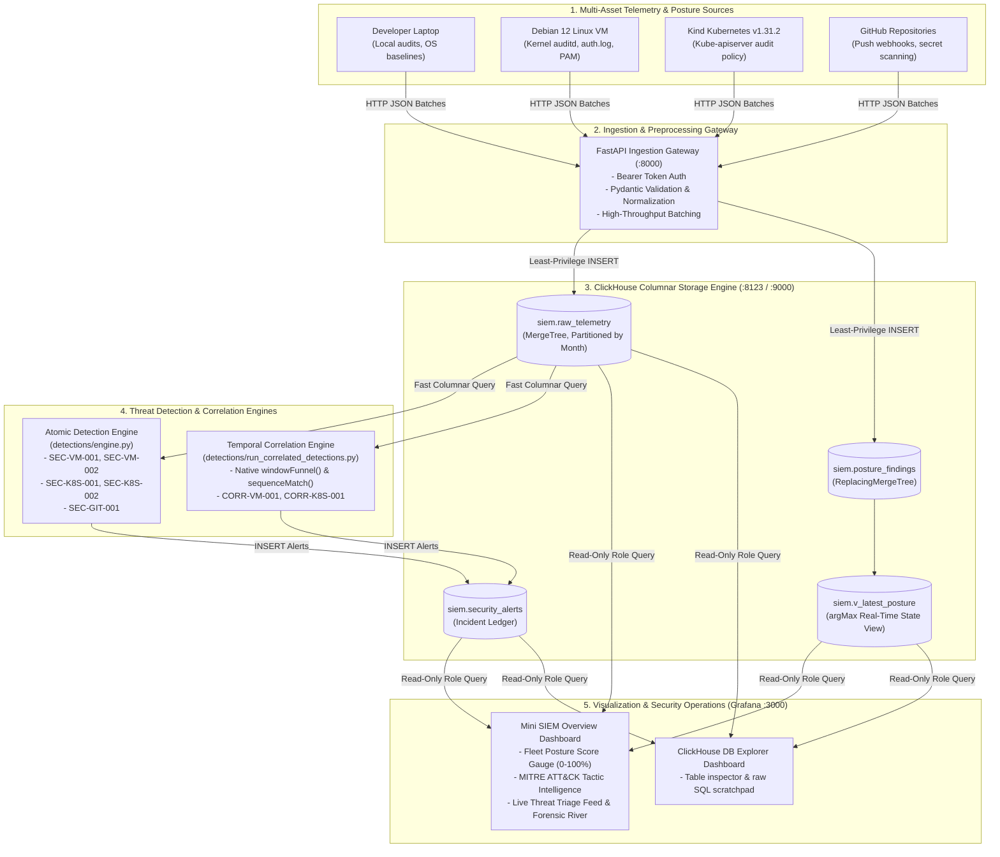

# Mini SIEM on ClickHouse

A high-performance, cloud-native Security Information and Event Management (SIEM) and Cloud Security Posture Management (CSPM) platform powered by **ClickHouse**.

Designed for modern multi-asset enterprise environments, this platform unifies **continuous posture auditing** (CVE vulnerability scanning and CIS configuration benchmarks) with **real-time runtime threat detection** (atomic detection rules and native temporal sequence correlation) across Developer Laptops, Linux Virtual Machines, Kubernetes Clusters, and GitHub Repositories.

---

## 1. System Architecture

The Mini SIEM platform is engineered with a decoupled, defense-in-depth architecture consisting of five distinct layers:



### Architectural Highlights
- **Columnar Analytics**: Leveraging ClickHouse's vectorized execution and LZ4 compression to achieve sub-second queries over hundreds of thousands of audit records.
- **Role-Based Access Control (RBAC)**: ClickHouse enforces strict least-privilege database roles:
  - `siem_ingestor_role`: Restricted exclusively to `INSERT` on `raw_telemetry` and `posture_findings`.
  - `siem_detector_role`: Restricted to `SELECT` on telemetry/posture and `INSERT/SELECT` on `security_alerts`.
  - `siem_dashboard_role`: Read-only access (`SELECT`) across all views and alert tables.
  - `siem_admin_role`: Full administrative schema management.
- **Idempotency & Deduplication**: State tracking files prevent alert storming and duplicate triage entries for identical event timestamps.

---

## 2. Unified Data Model

The data layer is partitioned into three core schemas and an optimized state tracking view within the `siem` database.

### 2.1. `siem.raw_telemetry` (High-Throughput Time-Series River)
Stores every normalized security log, process execution, auditd event, and API access record.

```sql
CREATE TABLE siem.raw_telemetry (
    timestamp DateTime64(3, 'UTC'),
    asset_type Enum8('laptop' = 1, 'vm' = 2, 'k8s' = 3, 'github' = 4),
    asset_id String,
    event_category LowCardinality(String),
    event_type LowCardinality(String),
    severity LowCardinality(String),
    actor String,
    source_ip Nullable(String),
    process_name Nullable(String),
    command_line Nullable(String),
    target_resource Nullable(String),
    raw_json String
) ENGINE = MergeTree()
PARTITION BY toYYYYMM(timestamp)
ORDER BY (asset_type, event_category, timestamp);
```

### 2.2. `siem.posture_findings` (Historical Posture Audits)
Stores every vulnerability scan result (CVEs via Trivy) and CIS benchmark configuration audit.

```sql
CREATE TABLE siem.posture_findings (
    finding_id UUID,
    scanned_at DateTime64(3, 'UTC'),
    asset_type Enum8('laptop' = 1, 'vm' = 2, 'k8s' = 3, 'github' = 4),
    asset_id String,
    check_id String,
    title String,
    finding_type Enum8('vulnerability' = 1, 'misconfiguration' = 2),
    severity Enum8('CRITICAL' = 1, 'HIGH' = 2, 'MEDIUM' = 3, 'LOW' = 4),
    status Enum8('OPEN' = 1, 'RESOLVED' = 2, 'SUPPRESSED' = 3),
    remediation String,
    raw_details String
) ENGINE = ReplacingMergeTree(scanned_at)
PARTITION BY asset_type
ORDER BY (asset_type, asset_id, check_id);
```

### 2.3. `siem.v_latest_posture` (Real-Time Current State View)
Because `ReplacingMergeTree` cleanups run asynchronously in the background, this view provides instantaneous, guaranteed deduplication by projecting only the latest scan status using ClickHouse's `argMax()` aggregate:

```sql
CREATE VIEW siem.v_latest_posture AS
SELECT
    asset_type,
    asset_id,
    check_id,
    argMax(finding_id, scanned_at) AS finding_id,
    max(scanned_at) AS scanned_at,
    argMax(title, scanned_at) AS title,
    argMax(finding_type, scanned_at) AS finding_type,
    argMax(severity, scanned_at) AS severity,
    argMax(status, scanned_at) AS status,
    argMax(remediation, scanned_at) AS remediation,
    argMax(raw_details, scanned_at) AS raw_details
FROM siem.posture_findings
GROUP BY asset_type, asset_id, check_id;
```

### 2.4. `siem.security_alerts` (Incident & Forensic Evidence Ledger)
Stores every triggered alert produced by the detection engines, enriched with MITRE ATT&CK metadata and self-contained JSON forensic evidence.

```sql
CREATE TABLE siem.security_alerts (
    alert_id UUID,
    triggered_at DateTime64(3, 'UTC'),
    rule_id String,
    rule_name String,
    mitre_tactic LowCardinality(String),
    mitre_technique LowCardinality(String),
    asset_type Enum8('laptop' = 1, 'vm' = 2, 'k8s' = 3, 'github' = 4),
    asset_id String,
    severity Enum8('CRITICAL' = 1, 'HIGH' = 2, 'MEDIUM' = 3, 'LOW' = 4),
    matched_events_count UInt32,
    alert_description String,
    evidence_context String,
    false_positive_tuning_notes String
) ENGINE = MergeTree()
PARTITION BY toYYYYMM(triggered_at)
ORDER BY (asset_type, rule_id, triggered_at);
```

---

## 3. Threat Detection Rules & Engines

The detection layer features both **Atomic Detection Rules** (evaluating specific indicators) and **Temporal Sequence Correlation Rules** (evaluating multi-stage attack graphs across time).

### 3.1. Atomic Detection Rules (`detections/rules/`)

| Rule ID | Rule Name | Asset | Severity | MITRE ATT&CK | Detection Logic Summary |
| :--- | :--- | :---: | :---: | :--- | :--- |
| **`SEC-VM-001`** | Unauthorized `/etc/shadow` Credential Dumping | `vm` | **CRITICAL** | **T1003.008** (Credential Access) | Matches non-PAM processes (`cat`, interactive shells) attempting reads on `/etc/shadow`. Suppresses routine daemons (`login`, `sshd`, `passwd`). |
| **`SEC-VM-002`** | Unauthorized Cron Persistence or Reverse Shell | `vm` | **HIGH** | **T1053.003** (Persistence) / **T1059.004** | Detects writes into `/etc/cron.d/` or execution of interactive reverse shells utilizing `/dev/tcp` or `bash -i`. |
| **`SEC-K8S-001`** | Privileged Pod Creation or Host Root Mount | `k8s` | **CRITICAL** | **T1610** / **T1611** (Privilege Escalation) | Identifies Kubernetes pods requesting `securityContext.privileged: true` or `hostPath: /`. Allowlists core CNI daemons in `kube-system`. |
| **`SEC-K8S-002`** | Interactive Container Exec & Credential Snooping | `k8s` | **HIGH** | **T1059** / **T1552.007** (Execution / Discovery) | Flags API server audit records with `verb=create` and `subresource=exec` into application pods, particularly targeting tokens in default namespaces. |
| **`SEC-GIT-001`** | High-Entropy Secret / AWS Token Committed | `github` | **CRITICAL** | **T1552.001** (Credential Access) | Scans git commit payloads for AWS access keys (`AKIA...`), ED25519/RSA private keys, and high-entropy API tokens pushed to branches. |

---

### 3.2. Temporal Sequence Correlation Rules (`detections/run_correlated_detections.py`)

Using ClickHouse's native `windowFunnel(window_seconds)` streaming function, the SIEM detects entire attack graphs within tight sliding windows, virtually eliminating false positives:

$$\text{windowFunnel}(\text{window\_seconds})(\text{toDateTime}(\text{timestamp}), \text{cond}_1, \text{cond}_2, \dots, \text{cond}_n)$$

#### Rule `CORR-VM-001`: Multi-Stage Linux Host Compromise Kill Chain
- **Target Asset**: Linux Virtual Machine (`prod-linux-vm-01` / `debianvm`)
- **Sliding Window**: **300 seconds (5 minutes)**
- **Severity**: **CRITICAL**
- **MITRE ATT&CK**: T1078 (Valid Accounts) $\rightarrow$ T1548.003 (Sudo) $\rightarrow$ T1003.008 (/etc/shadow)
- **Sequence Stages**:
  1. **Stage 1 (Initial Access)**: Remote SSH session established (`sshd-session` / `PAM:session_open`).
  2. **Stage 2 (Privilege Escalation)**: Sudo command executed by authenticated user (`/usr/bin/sudo`).
  3. **Stage 3 (Credential Harvesting)**: Privileged access to `/etc/shadow` via `cat /etc/shadow`.

```sql
SELECT
    asset_id,
    windowFunnel(300)(
        toDateTime(timestamp),
        (process_name IN ('sshd', 'sshd-session') OR command_line LIKE '%sshd%' OR command_line LIKE '%USER_LOGIN%' OR event_type = 'ssh_login_success'),
        (process_name = 'sudo' OR command_line LIKE '%/usr/bin/sudo%' OR event_type IN ('sudo_execution', 'sudo_command')),
        (target_resource = '/etc/shadow' OR command_line LIKE '%/etc/shadow%' OR event_type = 'sensitive_file_access')
    ) AS funnel_stage,
    min(timestamp) AS chain_started,
    max(timestamp) AS chain_ended
FROM siem.raw_telemetry
WHERE asset_type = 'vm' AND timestamp >= now() - INTERVAL 60 MINUTE
GROUP BY asset_id
HAVING funnel_stage >= 3;
```

#### Rule `CORR-K8S-001`: Multi-Stage Kubernetes Cluster Compromise Kill Chain
- **Target Asset**: Kubernetes Cluster (`kind-siem-k8s`)
- **Sliding Window**: **600 seconds (10 minutes)**
- **Severity**: **CRITICAL**
- **MITRE ATT&CK**: T1059 (Pod Exec) $\rightarrow$ T1552.007 (Token Read) $\rightarrow$ T1611 (Host Escape)
- **Sequence Stages**:
  1. **Stage 1 (Workload Breach)**: Interactive command execution inside unprivileged pod (`kubectl exec`).
  2. **Stage 2 (Credential Snooping)**: Attacker reads ServiceAccount token or queries cluster secrets (`/var/run/secrets/...`).
  3. **Stage 3 (Container Escape)**: Attacker deploys privileged container mounting host root `/` (`corr_k8s_escape_pod.yaml`).

```sql
SELECT
    asset_id,
    windowFunnel(600)(
        toDateTime(timestamp),
        (event_type LIKE '%exec%' OR command_line LIKE '%exec%'),
        (event_type LIKE '%secret%' OR target_resource LIKE '%secret%' OR command_line LIKE '%secret%' OR command_line LIKE '%serviceaccount%'),
        (event_type = 'create_privileged_pod' OR command_line LIKE '%privileged%' OR target_resource LIKE '%escape%')
    ) AS funnel_stage,
    min(timestamp) AS chain_started,
    max(timestamp) AS chain_ended
FROM siem.raw_telemetry
WHERE asset_type = 'k8s' AND timestamp >= now() - INTERVAL 60 MINUTE
GROUP BY asset_id
HAVING funnel_stage >= 3;
```

---

## 4. Attack Scenarios & Automated Red Team Simulations

The repository provides automated attack scripts to demonstrate end-to-end detection against live environments.

### 4.1. Atomic Attack Scenarios (`attacks/`)

```
attacks/
├── attack_1_cred_dump.sh           # Scenario 1: Linux /etc/shadow dumping
├── attack_2_reverse_shell.sh        # Scenario 2: Cron persistence & reverse shell
├── attack_3_privileged_pod.sh       # Scenario 3: K8s privileged pod host escape
├── attack_4_k8s_exec.sh             # Scenario 4: K8s interactive pod exec & token snooping
├── attack_5_git_secret_leak.py      # Scenario 5: Real ED25519 key leak to unique remote git branch
└── simulate_all_attacks.py          # Master orchestrator for atomic attacks
```

1. **Scenario 1 (Linux VM Credential Dumping)**:
   - Command: `bash attacks/attack_1_cred_dump.sh`
   - Executes unprivileged and privileged reads against `/etc/shadow` on `debianvm`, flushes auditd telemetry, and triggers `SEC-VM-001`.
2. **Scenario 2 (Linux VM Persistence & Reverse Shell)**:
   - Command: `bash attacks/attack_2_reverse_shell.sh`
   - Plants a malicious cron entry in `/etc/cron.d/backdoor` and tests `/dev/tcp` socket calls, triggering `SEC-VM-002`.
3. **Scenario 3 (Kubernetes Privileged Escape Pod)**:
   - Command: `bash attacks/attack_3_privileged_pod.sh`
   - Deploys a container with `securityContext.privileged: true` and a host volume mount to `/`, cleans up the pod, and triggers `SEC-K8S-001`.
4. **Scenario 4 (Kubernetes Pod Exec & Token Harvesting)**:
   - Command: `bash attacks/attack_4_k8s_exec.sh`
   - Spawns a victim app, issues `kubectl exec` to snoop container credentials, cleans up, and triggers `SEC-K8S-002`.
5. **Scenario 5 (GitHub Cryptographic Secret Leak)**:
   - Command: `python attacks/attack_5_git_secret_leak.py`
   - Generates live ED25519 key pairs and pushes them to a uniquely randomized remote branch (`canary-leak-xxxx`) on GitHub, triggering `SEC-GIT-001`.

---

### 4.2. Correlated Multi-Stage Attack Scenarios (`attacks/correlated/`)

```
attacks/correlated/
├── attack_corr_vm_killchain.sh      # Correlated VM Kill Chain (SSH -> Sudo -> Shadow)
├── attack_corr_k8s_killchain.sh     # Correlated K8s Kill Chain (Exec -> Secret -> Escape)
├── corr_k8s_escape_pod.yaml         # Privileged root mount container manifest
└── simulate_correlated_attacks.py   # Master runner for correlated scenarios
```

1. **VM Host Compromise Kill Chain (`CORR-VM-001`)**:
   - Command: `bash attacks/correlated/attack_corr_vm_killchain.sh`
   - Executes SSH authentication $\rightarrow$ `sudo id` elevation $\rightarrow$ `/etc/shadow` dump in under 2 minutes.
   - Evaluates ClickHouse `windowFunnel(300)` and outputs a single high-fidelity CRITICAL alert with complete chronological timeline evidence.
2. **Kubernetes Cluster Compromise Kill Chain (`CORR-K8S-001`)**:
   - Command: `bash attacks/correlated/attack_corr_k8s_killchain.sh`
   - Starts a victim workload $\rightarrow$ executes commands inside container $\rightarrow$ extracts ServiceAccount JWT token $\rightarrow$ deploys privileged escape pod mounting host node root `/` $\rightarrow$ cleans up.
   - Evaluates ClickHouse `windowFunnel(600)` and records a single CRITICAL alert with all stages mapped.

---

## 5. Grafana Security Operations Dashboards

Two production dashboards are provisioned out-of-the-box:

### 5.1. Mini SIEM - Fleet Security Overview (`/d/mini-siem-overview`)
- **Fleet Posture Score (0-100% Gauge)**: Evaluates overall health across verified production assets:
  $$\text{Score} = \text{round}\Big(\max\Big(10, \; 100 - \big(5 \cdot N_{\text{CRIT}} + 3 \cdot N_{\text{HIGH}} + 1 \cdot N_{\text{MED}}\big)\Big), \; 0\Big)$$
- **Executive KPI Cards**: Critical Findings (`14`), High Findings (`16`), Active Alerts Last 1h (`12`), Total Detections Fired (`79`), Total Telemetry Ingested (`708,000+`).
- **Open Posture Findings by Asset & Type**: Stacked bar chart isolating CVE vulnerabilities vs CIS misconfigurations.
- **Detections by MITRE ATT&CK Tactic**: Donut distribution showing active threat vector coverage (Credential Access ~60%, Execution ~14%, Privilege Escalation ~13%).
- **Live Alert Feed with Inline Forensics**: Interactive table showing triggered rules with self-contained JSON `evidence_context`.
- **Live Multi-Asset Telemetry Stream**: Real-time river of normalized logs across Laptop, VM, Kubernetes, and GitHub.

### 5.2. ClickHouse DB Explorer (`/d/clickhouse-db-explorer`)
- **Database Storage & Compression Metrics**: Real-time disk footprint, uncompressed bytes, compressed bytes, and compression ratios from `system.parts`.
- **Interactive Raw Table Browser**: Paginated inspection of `raw_telemetry`, `posture_findings`, and `security_alerts`.
- **Ad-Hoc SQL Runner Scratchpad**: Live editable SQL panel for threat hunting queries.

---

## 6. Quick Start & Execution Guide

### Prerequisites
- Docker & Docker Compose
- Python 3.10+ (with virtual environment)
- Kind (Kubernetes in Docker)
- SSH access to Debian VM (optional for VM attacks; mock mode supported)

### Step 1: Start Infrastructure (ClickHouse & Grafana)
```bash
docker compose up -d
```
Verify containers:
- ClickHouse HTTP: `http://localhost:8123`
- ClickHouse Native: `localhost:9000`
- Grafana: `http://localhost:3000` (User: `admin`, Password: `admin`)

### Step 2: Set Up Python Virtual Environment
```bash
python3 -m venv .venv
source .venv/bin/activate
pip install -r requirements.txt
```

### Step 3: Initialize Database Schema & Ingestion Gateway
```bash
# Apply ClickHouse DDL schema & RBAC roles
python src/schema/init_db.py

# Launch Ingestion Gateway daemon
uvicorn src.gateway.app:app --host 0.0.0.0 --port 8000 &
```

### Step 4: Run Posture Scanners
```bash
python posture/run_posture_scans.py
```

### Step 5: Execute Attack Simulations & Verify Detections
```bash
# Run all atomic attack scenarios:
python attacks/simulate_all_attacks.py

# Run both multi-stage correlated kill-chain scenarios:
python attacks/correlated/simulate_correlated_attacks.py --scenario all
```

### Step 6: Run Integration Tests
```bash
pytest tests/ -v
```

---

## 7. Repository Layout

```
mini-siem-clickhouse/
├── assets/                          # Asset telemetry collectors
│   ├── github/                      # GitHub audit webhook & repo collector
│   ├── k8s/                         # K8s API server audit log collector
│   ├── laptop/                      # Developer workstation collector
│   └── vm/                          # Linux VM auditd & auth.log collector
├── attacks/                         # Attack simulation scripts
│   ├── attack_1_cred_dump.sh
│   ├── attack_2_reverse_shell.sh
│   ├── attack_3_privileged_pod.sh
│   ├── attack_4_k8s_exec.sh
│   ├── attack_5_git_secret_leak.py
│   ├── correlated/                  # Temporal sequence correlation attacks
│   │   ├── attack_corr_vm_killchain.sh
│   │   ├── attack_corr_k8s_killchain.sh
│   │   ├── corr_k8s_escape_pod.yaml
│   │   └── simulate_correlated_attacks.py
│   └── simulate_all_attacks.py
├── dashboards/                      # Provisioned Grafana dashboard JSONs
│   ├── clickhouse_db_explorer.json  # DB Explorer companion dashboard
│   └── mini_siem_overview.json      # Primary SIEM executive dashboard
├── detections/                      # Detection engineering engine & rules
│   ├── engine.py                    # Atomic detection engine
│   ├── run_correlated_detections.py # Native windowFunnel() correlation engine
│   └── rules/                       # SQL detection rule definitions
├── docs/                            # In-depth architectural & runbook docs
│   ├── correlated_detections.md     # Temporal correlation guide
│   └── dashboard_guide.md           # Dashboard metrics & calculations
├── posture/                         # Posture auditing & compliance scanners
│   ├── run_posture_scans.py         # Multi-asset posture auditor
│   └── scanners/                    # CIS benchmark & CVE scanner modules
├── src/                             # Core framework source code
│   ├── common/                      # Database clients & environment helpers
│   ├── gateway/                     # FastAPI ingestion gateway
│   └── schema/                      # ClickHouse DDL & migrations
└── tests/                           # Pytest integration & unit test suite
    ├── integration/                 # Gateway, ClickHouse, and Detection tests
    └── unit/                        # Rule query builder & parser tests
```

---

## 8. License
Distributed under the Apache 2.0 License. See `LICENSE` for details.
