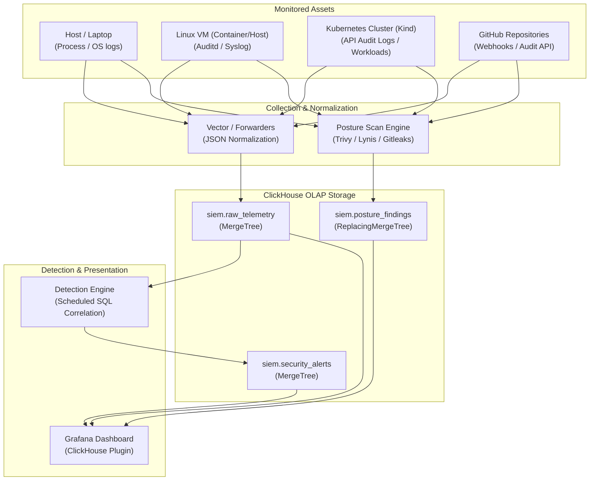

# Mini SIEM Architecture & Data Flow

## 1. System Components

## 2. Ingestion Strategy

1. **High-Throughput Raw Telemetry**:
   - Normalized into `asset_type`, `asset_id`, `event_category`, `event_type`, `actor`, `source_ip`, `process_name`, `command_line`, `target_resource`, and `raw_json`.
   - Indexed and partitioned by month for rapid analytical filtering.

2. **Deduplicated Posture State**:
   - `ReplacingMergeTree` keyed on `(asset_type, asset_id, check_id)` ensures that subsequent scans update findings without accumulating stale duplicates.

3. **Detection Engine**:
   - Runs deterministic, explainable SQL queries against `raw_telemetry`.
   - Populates `security_alerts` with MITRE ATT&CK metadata and forensic context.
