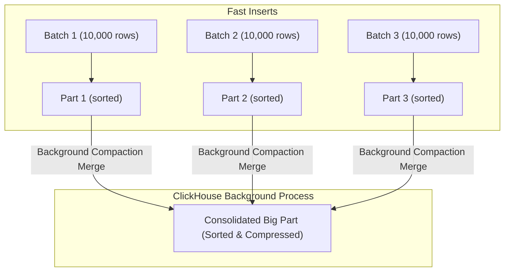

# Columnar Databases and ClickHouse Engines Explained

A short, beginner-friendly guide for developers and security engineers coming from traditional row-based databases (PostgreSQL, MySQL, SQLite) to **ClickHouse** and **columnar storage**.

---

## 1. The Core Mental Shift: Row-Oriented vs. Column-Oriented

Traditional databases store data **row by row**. Columnar databases store data **column by column**.

```
Row-Oriented (Postgres / MySQL):
[Row 1: 10:00:01, vm, CRITICAL, "root", "cat /etc/shadow"]
[Row 2: 10:00:02, k8s, INFO,    "alice", "kubectl get pods"]
[Row 3: 10:00:03, vm, LOW,     "bob",   "ls -la"]

Column-Oriented (ClickHouse):
File 1 (timestamp):   [ 10:00:01, 10:00:02, 10:00:03 ]
File 2 (asset_type):  [ vm, k8s, vm ]
File 3 (severity):    [ CRITICAL, INFO, LOW ]
File 4 (actor):       [ "root", "alice", "bob" ]
File 5 (command_line):[ "cat /etc/shadow", "kubectl get pods", "ls -la" ]
```

### Why Does This Matter for SIEM and Analytics?
Suppose you run this query over **100,000,000 log events**:
```sql
SELECT count() FROM siem.raw_telemetry WHERE severity = 'CRITICAL';
```

| Database Type | What the Disk Must Read | Result |
| :--- | :--- | :--- |
| **Row-Oriented (Postgres/MySQL)** | Must read **every single byte of all 100M rows** (including huge payloads, JSONs, commands) just to check the `severity` field. | **Slow (Minutes)**, high disk I/O bottlenecks. |
| **Column-Oriented (ClickHouse)** | Reads **only the `severity` column file** off disk. It never even opens the giant `command_line` or `raw_json` files. | **Blazing Fast (< 20ms)**, reads 95% less data. |

### Superpower: Massive Data Compression
Because identical data types sit adjacent to each other on disk (e.g., millions of strings repeating `'vm'` or `'INFO'`), ClickHouse compresses data with LZ4/ZSTD by **5x to 15x**. 100 GB of raw logs compresses down to ~10 GB.

---

## 2. What Is a "MergeTree"?

In ClickHouse, table engines ending with **`MergeTree`** are the core workhorses.

### Why Is It Called "MergeTree"?
ClickHouse is inspired by **LSM Trees** (Log-Structured Merge-Trees):
1. When you insert a batch of events, ClickHouse writes an immutable, sorted chunk to disk called a **"part"**.
2. Writing a new part is extremely fast (append-only, no in-place locks).
3. In the background, ClickHouse automatically picks up smaller parts and **merges** them into larger, sorted parts.



---

## 3. `MergeTree` vs. `ReplacingMergeTree`

The two engines used across our Mini-SIEM are `MergeTree` and `ReplacingMergeTree`.

### 3.1. Standard `MergeTree` (The Immutable Stream Engine)
- **Concept**: Append-only, historical time-series ledger. Once written, events never change.
- **Behavior**: Every inserted row is preserved forever.
- **Where we use it in Mini-SIEM**:
  - `siem.raw_telemetry`: Raw logs (an SSH login from 10 minutes ago never changes).
  - `siem.security_alerts`: Fired alerts (an alert record is an immutable audit artifact).

```sql
CREATE TABLE siem.raw_telemetry (
    timestamp DateTime64(3, 'UTC'),
    asset_type Enum8('laptop'=1, 'vm'=2, 'k8s'=3, 'github'=4),
    severity LowCardinality(String),
    ...
) ENGINE = MergeTree()
PARTITION BY toYYYYMM(timestamp)
ORDER BY (asset_type, event_category, timestamp);
```

---

### 3.2. `ReplacingMergeTree` (The State & Deduplication Engine)
- **Concept**: Used when rows have a **lifecycle** and change state (e.g., a vulnerability goes from `OPEN` to `RESOLVED`).
- **The Problem It Solves**: ClickHouse does not do transactional `UPDATE table SET status = 'RESOLVED' WHERE id = 123`. That would destroy columnar performance.
- **How It Works**:
  1. Define a version column: `ENGINE = ReplacingMergeTree(scanned_at)`.
  2. Define the unique primary key: `ORDER BY (asset_type, asset_id, check_id)`.
  3. When an engineer fixes a vulnerability, the scanner runs again and simply **`INSERT`s a new row** with the new status (`RESOLVED`) and a newer `scanned_at` timestamp.
  4. When ClickHouse merges parts in the background, it compares the `ORDER BY` key. If it sees two rows with the same key, **it automatically discards the older row and keeps the newest version**!

```sql
CREATE TABLE siem.posture_findings (
    asset_type Enum8('laptop'=1, 'vm'=2, 'k8s'=3, 'github'=4),
    asset_id String,
    check_id String,
    status Enum8('OPEN'=1, 'RESOLVED'=2),
    scanned_at DateTime64(3, 'UTC')
) ENGINE = ReplacingMergeTree(scanned_at)
ORDER BY (asset_type, asset_id, check_id);
```

---

## 4. Why Do We Need `FINAL` or a View with `ReplacingMergeTree`?

Here is the one catch to remember:

> **The replacement happens asynchronously in the background.**

If you insert an update at 12:00:00 and run a query at 12:00:01, the background merge might not have happened yet. On disk, both rows still exist!

```
Row 1 (Older): [ prod-vm, CIS-SSH-01, OPEN,     11:00:00 ]
Row 2 (Newer): [ prod-vm, CIS-SSH-01, RESOLVED, 12:00:00 ]
```

To solve this, ClickHouse gives you two options:

### Option A: Query with `FINAL`
```sql
SELECT * FROM siem.posture_findings FINAL WHERE status = 'OPEN';
```
`FINAL` tells ClickHouse: *"Even if background merge hasn't finished, deduplicate these rows in memory right now before returning results to me."*

### Option B: Wrap it in a View (What we did in Mini-SIEM!)
```sql
CREATE VIEW siem.v_latest_posture AS
SELECT * FROM siem.posture_findings FINAL;
```
Now Grafana and detection engines simply query:
```sql
SELECT count() FROM siem.v_latest_posture WHERE status = 'OPEN';
```
This hides the deduplication complexity and guarantees that your **Fleet Posture Score** and finding counts are **100% accurate in real time**.

---

## 5. Quick Comparison Cheat Sheet

| Feature | Standard `MergeTree` | `ReplacingMergeTree` |
| :--- | :--- | :--- |
| **Primary Use Case** | Append-only logs, metrics, events | Updatable entity state (CVEs, inventory, accounts) |
| **How Updates Work** | No updates (immutable) | `INSERT` a new row with higher version/timestamp |
| **Deduplication** | None (keeps every record) | Merges rows with the same `ORDER BY` key, keeping newest |
| **Requires `FINAL`?** | No | Yes (or use a view) for immediate query-time consistency |
| **Mini-SIEM Example** | `siem.raw_telemetry`, `siem.security_alerts` | `siem.posture_findings` (via `v_latest_posture`) |

---

## 6. Summary in 3 Sentences

1. **Columnar databases** (ClickHouse) store each column in a separate file, making aggregation queries over millions of security logs 100x faster than traditional row databases.
2. **`MergeTree`** is an append-only engine for immutable event streams like raw telemetry and security alerts.
3. **`ReplacingMergeTree`** allows simulating updates without performance-killing row locks, deduplicating older states in the background and giving you real-time state when queried through a view.
