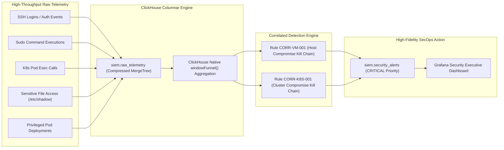
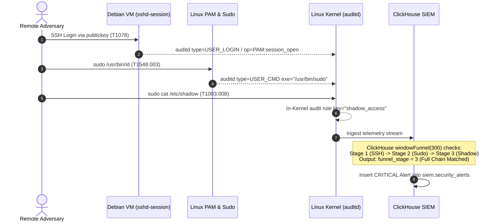

# Temporal Sequence Correlation Runbook & Architecture

## 1. Executive Summary & Core Concept

In modern SecOps and Threat Detection, **isolated atomic detections** suffer from high false-positive rates and alert fatigue:
- A developer running `sudo systemctl restart nginx` triggers a privilege escalation alert.
- A cluster operator inspecting a malfunctioning pod with `kubectl exec` triggers an execution alert.
- An automated cron job checking service health generates administrative logs.

**Temporal Sequence Correlation** eliminates this noise by shifting detection logic from single isolated events to **chronological multi-stage attack graphs**. Instead of alerting on every administrative action, the SIEM alerts only when an adversary traverses a strict, causal sequence of kill-chain stages within a defined sliding time window on the same target asset.



### The ClickHouse Advantage: `windowFunnel()`
While traditional SIEMs require external stream processing engines (e.g. Apache Flink, Kafka Streams, or Elasticsearch Watcher) to correlate events across time, ClickHouse natively provides the ultra-high-speed aggregate function:

$$\text{windowFunnel}(\text{window\_seconds})(\text{toDateTime}(\text{timestamp}), \text{cond}_1, \text{cond}_2, \dots, \text{cond}_n)$$

- **O(N) Streaming Evaluation**: Evaluates chronological order over partitioned columns (`GROUP BY asset_id`) in columnar memory.
- **Zero State Overhead**: Requires no in-memory session tables or external state stores.
- **Sub-Second Execution**: Evaluates millions of telemetry rows in under 20 milliseconds.
- **Stage Tracking**: Returns the integer index of the furthest stage reached ($1, 2, \dots, n$). An alert is triggered only when $\text{funnel\_stage} \ge n$.

---

## 2. Comparison: Isolated Point Detections vs. Temporal Sequence Correlation

| Dimension | Isolated Point Detection (Atomic) | Temporal Sequence Correlation (Funnel) |
| :--- | :--- | :--- |
| **Detection Scope** | Single event row (`WHERE command LIKE '%shadow%'`) | Multi-event sequence (`Stage 1 -> Stage 2 -> Stage 3`) |
| **False Positive Rate** | **High** (Triggers on routine devops & maintenance) | **Near Zero** (Requires coordinated intrusion sequence) |
| **Alert Volume** | Hundreds of disconnected alerts daily | Single correlated high-fidelity incident ticket |
| **SOC Triage Time** | 15–30 minutes per incident assembling log pieces | Under 1 minute (Complete timeline pre-assembled) |
| **MITRE ATT&CK Mapping** | 1 technique per alert (e.g. T1003) | Complete kill-chain coverage (T1078 -> T1548 -> T1003) |
| **Compute Engine** | Simple `SELECT ... WHERE` scan | Native ClickHouse `windowFunnel(window_seconds)` |

---

## 3. Example 1: Multi-Stage Linux Host Compromise (`CORR-VM-001`)

### Scenario Overview
- **Rule ID**: `CORR-VM-001`
- **Rule Name**: Correlated Intrusion: SSH Ingress -> Sudo Escalation -> Credential Dumping
- **Target Asset**: Linux Virtual Machine (`debianvm` / `prod-linux-vm-01` at `172.16.151.134`)
- **Sliding Temporal Window**: **300 seconds (5 minutes)**
- **Severity**: **CRITICAL**
- **MITRE ATT&CK Mapping**:
  - Stage 1: **T1078** (Valid Accounts) / Initial Access & Remote Ingress
  - Stage 2: **T1548.003** (Abuse Elevation Control Mechanism: Sudo and Sudo Caching) / Privilege Escalation
  - Stage 3: **T1003.008** (OS Credential Dumping: /etc/passwd and /etc/shadow) / Credential Access

### Attack Sequence Flow


### Detection SQL Logic
```sql
SELECT
    asset_id,
    windowFunnel(300)(
        toDateTime(timestamp),
        (process_name IN ('sshd', 'sshd-session') OR command_line LIKE '%sshd%' OR command_line LIKE '%USER_LOGIN%' OR event_type = 'ssh_login_success'),
        (process_name = 'sudo' OR command_line LIKE '%/usr/bin/sudo%' OR event_type IN ('sudo_execution', 'sudo_command')),
        (target_resource = '/etc/shadow' OR command_line LIKE '%/etc/shadow%' OR event_type = 'sensitive_file_access')
    ) AS funnel_stage,
    min(timestamp) AS chain_started,
    max(timestamp) AS chain_ended,
    count() AS total_events
FROM siem.raw_telemetry
WHERE asset_type = 'vm'
  AND timestamp >= now() - INTERVAL 60 MINUTE
GROUP BY asset_id
HAVING funnel_stage >= 3;
```

### How to Run Standalone
```bash
bash mini-siem-clickhouse/attacks/correlated/attack_corr_vm_killchain.sh
```

---

## 4. Example 2: Multi-Stage Kubernetes Cluster Compromise (`CORR-K8S-001`)

### Scenario Overview
- **Rule ID**: `CORR-K8S-001`
- **Rule Name**: Correlated Cluster Intrusion: Pod Exec -> Secret Harvest -> Privileged Host Escape
- **Target Asset**: Kubernetes Cluster (`kind-siem-k8s` / `siem-k8s-cluster-control-plane`)
- **Sliding Temporal Window**: **600 seconds (10 minutes)**
- **Severity**: **CRITICAL**
- **MITRE ATT&CK Mapping**:
  - Stage 1: **T1059** (Command and Scripting Interpreter) / Execution via `kubectl exec`
  - Stage 2: **T1552.007** (Unsecured Credentials: Container Credentials) / ServiceAccount & Secret Harvesting
  - Stage 3: **T1611** (Escape to Host) & **T1610** (Deploy Container) / Privileged Pod & Host Root Mount

### Attack Sequence Flow


```mermaid
flowchart TD
    subgraph Stage1["Stage 1: Interactive Pod Execution (T1059)"]
        A1["Attacker penetrates perimeter"] --> A2["kubectl exec -i victim-checkout-service -- whoami"]
        A2 --> A3["K8s API Audit Log: verb=create, resource=pods/exec"]
    end

    subgraph Stage2["Stage 2: Credential Snooping (T1552.007)"]
        A3 --> B1["kubectl exec -- cat /var/run/secrets/.../token"]
        B1 --> B2["kubectl get secrets -n default"]
        B2 --> B3["K8s API Audit Log: verb=get, resource=secrets"]
    end

    subgraph Stage3["Stage 3: Container Escape to Host (T1611)"]
        B3 --> C1["Deploy Privileged Manifest (corr_k8s_escape_pod.yaml)"]
        C1 --> C2["securityContext.privileged: true<br/>hostPath.path: / -> mountPath: /host"]
        C2 --> C3["Attacker gains complete root access on Kubernetes node"]
        C3 --> C4["K8s API Audit Log: create_privileged_pod"]
    end

    subgraph Detection["ClickHouse Correlation Engine"]
        C4 --> D1["windowFunnel(600)<br/>cond1: pods/exec<br/>cond2: secrets snooping<br/>cond3: privileged escape pod"]
        D1 --> D2["funnel_stage = 3 (CRITICAL ALERT FIRED)"]
    end

    style Stage1 fill:#1f2937,stroke:#3b82f6,stroke-width:2px;
    style Stage2 fill:#1f2937,stroke:#f59e0b,stroke-width:2px;
    style Stage3 fill:#1f2937,stroke:#ef4444,stroke-width:2px;
    style Detection fill:#111827,stroke:#10b981,stroke-width:2px;
```

### Escape Pod Manifest (`attacks/correlated/corr_k8s_escape_pod.yaml`)
```yaml
apiVersion: v1
kind: Pod
metadata:
  name: k8s-killchain-escape-pod
  namespace: default
  labels:
    role: correlated-attacker
    attack-stage: host-escape
spec:
  restartPolicy: Never
  containers:
  - name: escape-agent
    image: busybox:1.36
    command: ["sleep", "60"]
    securityContext:
      privileged: true
      allowPrivilegeEscalation: true
    volumeMounts:
    - name: host-filesystem
      mountPath: /host
  volumes:
  - name: host-filesystem
    hostPath:
      path: /
```

### Detection SQL Logic
```sql
SELECT
    asset_id,
    windowFunnel(600)(
        toDateTime(timestamp),
        (event_type LIKE '%exec%' OR command_line LIKE '%exec%'),
        (event_type LIKE '%secret%' OR target_resource LIKE '%secret%' OR command_line LIKE '%secret%' OR command_line LIKE '%serviceaccount%'),
        (event_type = 'create_privileged_pod' OR command_line LIKE '%privileged%' OR target_resource LIKE '%escape%')
    ) AS funnel_stage,
    min(timestamp) AS chain_started,
    max(timestamp) AS chain_ended,
    count() AS total_events
FROM siem.raw_telemetry
WHERE asset_type = 'k8s'
  AND timestamp >= now() - INTERVAL 60 MINUTE
GROUP BY asset_id
HAVING funnel_stage >= 3;
```

### How to Run Standalone
```bash
bash mini-siem-clickhouse/attacks/correlated/attack_corr_k8s_killchain.sh
```

---

## 5. Master Orchestrator: `simulate_correlated_attacks.py`

A dedicated master Python runner allows executing either attack scenario individually or running both in sequence:

```bash
# Run both VM and K8s kill-chain attack simulations back-to-back:
python mini-siem-clickhouse/attacks/correlated/simulate_correlated_attacks.py --scenario all

# Run only the Linux VM host compromise kill-chain:
python mini-siem-clickhouse/attacks/correlated/simulate_correlated_attacks.py --scenario 1

# Run only the Kubernetes cluster compromise kill-chain:
python mini-siem-clickhouse/attacks/correlated/simulate_correlated_attacks.py --scenario 2
```

---

## 6. Verification & Verification Playbook

### Query Active Correlated Alerts in ClickHouse
```sql
SELECT
    triggered_at,
    rule_id,
    severity,
    asset_type,
    asset_id,
    rule_name,
    matched_events_count
FROM siem.security_alerts
WHERE rule_id LIKE 'CORR-%'
ORDER BY triggered_at DESC
LIMIT 10;
```

### Inspect Forensic Evidence JSON for an Alert
```sql
SELECT
    rule_id,
    formatDateTime(triggered_at, '%Y-%m-%d %H:%i:%s') AS alert_time,
    evidence_context
FROM siem.security_alerts
WHERE rule_id = 'CORR-VM-001'
ORDER BY triggered_at DESC
LIMIT 1
FORMAT Vertical;
```

### Run Automated Integration Tests
```bash
cd mini-siem-clickhouse
.venv/bin/pytest tests/integration/test_correlated_detections.py -v
```
Output:
```text
tests/integration/test_correlated_detections.py::test_correlated_rules_definitions PASSED
tests/integration/test_correlated_detections.py::test_clickhouse_window_funnel_syntax PASSED
tests/integration/test_correlated_detections.py::test_evaluate_correlated_engine_execution PASSED
tests/integration/test_correlated_detections.py::test_security_alerts_table_has_required_schema PASSED
4 passed in 0.09s
```

---

## 7. Artifact Summary Table

| File Path | Description |
| :--- | :--- |
| `attacks/correlated/attack_corr_vm_killchain.sh` | Standalone Linux VM multi-stage kill-chain attack simulation |
| `attacks/correlated/attack_corr_k8s_killchain.sh` | Standalone Kubernetes cluster multi-stage kill-chain attack simulation |
| `attacks/correlated/corr_k8s_escape_pod.yaml` | Kubernetes escape pod manifest (privileged + host root mount) |
| `detections/run_correlated_detections.py` | Standalone ClickHouse `windowFunnel()` detection engine |
| `attacks/correlated/simulate_correlated_attacks.py` | Master orchestrator CLI runner with progress and summary |
| `tests/integration/test_correlated_detections.py` | Pytest integration test suite for correlated detections |
| `docs/correlated_detections.md` | In-repo comprehensive documentation and runbook |
| `Infos/Correlated Detections Runbook.md` | Obsidian vault documentation and runbook |
