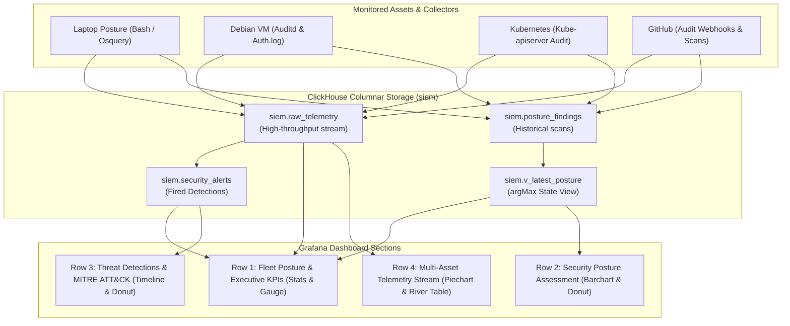

# Mini SIEM Executive & Operational Dashboard Guide

## 1. Executive Summary & Dashboard Architecture

The **Mini SIEM Fleet Security Overview** dashboard (`mini-siem-overview`, Grafana UID: `mini-siem-overview`) is the single pane of glass for real-time visibility into the multi-asset enterprise environment. It unifies **cloud-native posture auditing (CSPM/KSPM)** with **real-time runtime threat detection (SIEM/XDR)** across four distinct asset classes:

1. **Developer Laptops / Workstations** (`asset_type = 'laptop'`)
2. **Production Linux Virtual Machines** (`asset_type = 'vm'`, e.g., Debian 12 `prod-linux-vm-01`)
3. **Container Orchestration Clusters** (`asset_type = 'k8s'`, e.g., Kind cluster `kind-siem-k8s`)
4. **Source Code Repositories** (`asset_type = 'github'`, e.g., `ShudarsanRegmi/mini-siem-clickhouse`)



---

## 2. Row 1: Fleet Security Posture & Executive KPIs (Top Stat Bar)

The top row delivers high-level key performance indicators (KPIs) designed for CISOs, SOC managers, and platform security engineers.

```
+-------------------------------------------------------------------------------------------------------+
|  [ Gauge: 75% ]    [ Stat: 14 ]    [ Stat: 16 ]    [ Stat: 12 ]    [ Stat: 79 ]    [ Stat: 708,389 ]  |
|   Fleet Posture    Critical Post.    High Post.     Active Alerts   Total Fired     Total Telemetry   |
|       Score           Findings        Findings        (Last 1h)      Detections        Ingested       |
+-------------------------------------------------------------------------------------------------------+
```

### 2.1. Fleet Posture Score (Gauge Panel: ID 101)
- **Current Value**: `75%` (Good / Warning boundary)
- **Visualization**: Radial Gauge with color-coded operational thresholds:
  - 🔴 **Red (< 50%)**: Critical failure — severe fleet risk requiring immediate stop-the-line intervention.
  - 🟠 **Orange (50% - 69%)**: Poor hygiene — multiple unaddressed critical/high vulnerabilities.
  - 🟡 **Yellow (70% - 84%)**: Moderate hygiene — primary controls in place, outstanding remediations present.
  - 🟢 **Green (85% - 100%)**: Strong security posture — compliance baselines met.

#### Mathematical Calculation & Formula
The score evaluates open security findings across the four core production assets:
$$\text{Fleet Posture Score} = \text{round}\Big(\max\Big(10, \; 100 - \big(5 \cdot N_{\text{CRITICAL}} + 3 \cdot N_{\text{HIGH}} + 1 \cdot N_{\text{MEDIUM}}\big)\Big), \; 0\Big)$$

Where:
- $N_{\text{CRITICAL}}$ is the count of open critical findings across verified production assets.
- $N_{\text{HIGH}}$ is the count of open high-severity findings across verified production assets.
- $N_{\text{MEDIUM}}$ is the count of open medium-severity findings across verified production assets.

#### ClickHouse SQL Query:
```sql
SELECT round(greatest(10, 100 - (
    countIf(severity = 'CRITICAL' AND status = 'OPEN') * 5 + 
    countIf(severity = 'HIGH' AND status = 'OPEN') * 3 + 
    countIf(severity = 'MEDIUM' AND status = 'OPEN') * 1
)), 0) AS posture_score 
FROM siem.v_latest_posture 
WHERE asset_id IN ('SUSHANKYA', 'prod-linux-vm-01', 'kind-siem-k8s', 'ShudarsanRegmi/mini-siem-clickhouse');
```

#### Why These Weights & Floor?
1. **Critical Penalty (-5% per finding)**: A single critical vulnerability (e.g., exposed root SSH key or RCE CVE) represents immediate exploitable danger. Two criticals incur a -10% penalty.
2. **High Penalty (-3% per finding)**: High findings (e.g., missing branch protections or unrestricted sudo) represent major compliance failures.
3. **Medium Penalty (-1% per finding)**: Medium findings reflect sub-optimal hygiene (e.g., permissive file permissions) but do not immediately yield remote root access.
4. **Low Severity (0% Penalty)**: Informational findings do not degrade production posture scores to prevent alert fatigue.
5. **Score Floor (`greatest(10, ...)` = 10%)**: Even in a severely compromised environment, the score never drops to 0 or negative numbers; a floor of 10% guarantees readability on executive dashboards.
6. **Live Data Proof**:
   - $N_{\text{CRITICAL}} = 2 \implies 2 \times 5 = 10$
   - $N_{\text{HIGH}} = 4 \implies 4 \times 3 = 12$
   - $N_{\text{MEDIUM}} = 3 \implies 3 \times 1 = 3$
   - Total Deductions $= 10 + 12 + 3 = 25$
   - Result $= 100 - 25 = 75\%$

---

### 2.2. Critical Posture Findings (Stat Panel: ID 1)
- **Current Value**: `14` (Filtered by active asset selector)
- **Color**: Solid Red Background (`colorMode: background`)
- **SQL Query**:
  ```sql
  SELECT countIf(severity = 'CRITICAL' AND status = 'OPEN') AS count 
  FROM siem.v_latest_posture 
  WHERE ('$asset_type' = 'all' OR asset_type = '$asset_type');
  ```
- **Operational Meaning**: Identifies immediately exploitable vulnerabilities (such as active CVEs in outdated packages) or zero-day misconfigurations that violate security baselines.

---

### 2.3. High Severity Posture (Stat Panel: ID 2)
- **Current Value**: `16`
- **Color**: Solid Orange Background
- **SQL Query**:
  ```sql
  SELECT countIf(severity = 'HIGH' AND status = 'OPEN') AS count 
  FROM siem.v_latest_posture 
  WHERE ('$asset_type' = 'all' OR asset_type = '$asset_type');
  ```
- **Operational Meaning**: Highlights significant architectural risks (e.g., lack of branch protection on `main`, SSH permit root login enabled, or permissive container security contexts).

---

### 2.4. Active Alerts (Last 1h) (Stat Panel: ID 102)
- **Current Value**: `12`
- **Color**: Solid Purple Background
- **SQL Query**:
  ```sql
  SELECT count() AS count 
  FROM siem.security_alerts 
  WHERE triggered_at >= now() - INTERVAL 1 HOUR 
    AND ('$asset_type' = 'all' OR asset_type = '$asset_type');
  ```
- **Operational Meaning**: Gauges **active threat tempo**. If this number is non-zero, an adversary or active security test is currently generating runtime detections within the last 60 minutes.

---

### 2.5. Total Detections Fired (Stat Panel: ID 3)
- **Current Value**: `79`
- **Color**: Purple / Blue
- **SQL Query**:
  ```sql
  SELECT count() AS count 
  FROM siem.security_alerts 
  WHERE ('$asset_type' = 'all' OR asset_type = '$asset_type');
  ```
- **Operational Meaning**: The cumulative historical ledger of all triggered detections across all detection rules (both atomic and correlated) stored in `siem.security_alerts`.

---

### 2.6. Total Telemetry Ingested (Stat Panel: ID 10)
- **Current Value**: `708,389`
- **Color**: Blue
- **SQL Query**:
  ```sql
  SELECT count() AS total_telemetry 
  FROM siem.raw_telemetry 
  WHERE ('$asset_type' = 'all' OR asset_type = '$asset_type');
  ```
- **Operational Meaning**: Verifies ingestion pipeline throughput and data plane health across all collectors feeding the ClickHouse database.

---

## 3. Row 2: Security Posture Assessment (Vulnerabilities & Misconfigurations)

This section isolates static security configuration issues and package vulnerabilities discovered during automated audits.

### 3.1. Open Posture Findings by Asset & Type (Barchart Panel: ID 201)
- **Visualization**: Grouped Bar Chart displaying **Vulnerabilities** vs. **Misconfigurations** per asset class.
- **SQL Query**:
  ```sql
  SELECT 
      asset_type, 
      countIf(finding_type = 'vulnerability' AND status = 'OPEN') AS vulnerabilities, 
      countIf(finding_type = 'misconfiguration' AND status = 'OPEN') AS misconfigurations 
  FROM siem.v_latest_posture 
  WHERE ('$asset_type' = 'all' OR asset_type = '$asset_type') 
  GROUP BY asset_type 
  ORDER BY asset_type;
  ```

#### Current Live Distribution:
| Asset Type | Vulnerabilities (CVEs) | Misconfigurations (CIS) | Total Open | Dominant Risk Factor |
| :--- | :---: | :---: | :---: | :--- |
| **`vm`** (Debian 12) | **14** | **15** | **29** | Package CVEs & OS Hardening gaps |
| **`k8s`** (Kind Cluster) | **0** | **3** | **3** | Anonymous auth & container escalation rules |
| **`github`** (Repo) | **0** | **2** | **2** | Branch protection & secret scanning settings |
| **`laptop`** (Host) | **0** | **1** | **1** | Local disk encryption / firewall status |

#### Why Is This Distribution Reasonable?
1. **VM High Finding Count (29 findings)**: A complete Debian Linux VM runs a full operating system with thousands of shared libraries, system utilities, and packages installed (`libc6`, `systemd`, `openssh-server`, `curl`). Vulnerability scanners like Trivy index every installed `.deb` package against the National Vulnerability Database (NVD) and Debian Security Bug Tracker, yielding real package CVEs alongside OS-level CIS benchmark checks.
2. **K8s, GitHub, and Laptop Misconfigurations (0 CVEs, few misconfigurations)**:
   - In our architecture, the Kubernetes cluster, GitHub repo, and Laptop are audited through **configuration auditing scanners** rather than container image vulnerability scanning.
   - For example, GitHub has no operating system packages; its posture is strictly defined by repository security policies (branch protection, push permissions, secret leak scanning).
   - Thus, the presence of 100% misconfigurations on GitHub and K8s is architecturally expected.

---

### 3.2. Posture Severity Distribution (Donut Piechart Panel: ID 202)
- **Visualization**: Donut chart displaying the proportion of open findings across severity tiers.
- **SQL Query**:
  ```sql
  SELECT severity, count() AS findings 
  FROM siem.v_latest_posture 
  WHERE status = 'OPEN' 
    AND ('$asset_type' = 'all' OR asset_type = '$asset_type') 
  GROUP BY severity 
  ORDER BY findings DESC;
  ```

#### Current Distribution:
- **HIGH**: 16 findings (45.7%)
- **CRITICAL**: 14 findings (40.0%)
- **MEDIUM**: 3 findings (8.6%)
- **LOW**: 2 findings (5.7%)

#### Why Is This Distribution Reasonable?
Security scanners deliberately suppress low-priority informational notices to prevent cluttering the database. As a result, the findings that enter the system are predominantly actionable issues with CVSS scores $\ge 7.0$ (High) or $\ge 9.0$ (Critical), leading to a high-density distribution of High and Critical items.

---

### 3.3. Actionable Security Posture & Remediation Inventory (Table Panel: ID 203)
- **Description**: Tactical remediation table providing SecOps engineers with the exact fix commands.
- **Columns**: `severity`, `asset_type`, `asset_id`, `finding_type`, `check_id`, `title`, `status`, `remediation`
- **SQL Query**:
  ```sql
  SELECT 
      severity, 
      asset_type, 
      asset_id, 
      finding_type, 
      check_id, 
      title, 
      status, 
      remediation 
  FROM siem.v_latest_posture 
  WHERE status = 'OPEN' 
    AND ('$asset_type' = 'all' OR asset_type = '$asset_type') 
  ORDER BY severity, asset_type 
  LIMIT 50;
  ```
- **How It Works**: Backed by `siem.v_latest_posture`, which uses ClickHouse's `argMax` state tracking over `siem.posture_findings`. When a remediation is applied and a new scan executes, the status transitions to `RESOLVED` and automatically drops off this view without requiring manual record deletion.

---

## 4. Row 3: Threat Detections & MITRE ATT&CK Intelligence

This section tracks **runtime detection engine results**, mapping attacks to the MITRE ATT&CK framework.

### 4.1. Alerts Volume Over Time by Severity (Stacked Bar Timeseries: ID 5)
- **Visualization**: Stacked time-series bar chart binned by minute (`toStartOfMinute(triggered_at)`).
- **SQL Query**:
  ```sql
  SELECT 
      toStartOfMinute(triggered_at) AS time, 
      severity, 
      count() AS alerts 
  FROM siem.security_alerts 
  WHERE ('$asset_type' = 'all' OR asset_type = '$asset_type') 
  GROUP BY time, severity 
  ORDER BY time ASC;
  ```
- **Operational Value**: Instantly exposes attack bursts. A flat line represents routine operation, whereas sudden vertical spikes reveal brute-force login attempts, automated reconnaissance, or exploit execution waves.

---

### 4.2. Detections by MITRE ATT&CK Tactic (Donut Piechart Panel: ID 301)
- **Visualization**: Donut chart displaying the distribution of alerts categorized by adversary objective.
- **SQL Query**:
  ```sql
  SELECT mitre_tactic, count() AS alerts 
  FROM siem.security_alerts 
  WHERE ('$asset_type' = 'all' OR asset_type = '$asset_type') 
  GROUP BY mitre_tactic 
  ORDER BY alerts DESC;
  ```

#### Current Live Distribution:
| MITRE ATT&CK Tactic | Alerts Count | Percentage | Primary Contributing Rules |
| :--- | :---: | :---: | :--- |
| **Credential Access** | **47** | **59.5%** | `SEC-VM-001` (/etc/shadow), `SEC-GIT-001` (Secret Push), `CORR-VM-001` |
| **Execution** | **11** | **13.9%** | `SEC-TEST-001` (Security Suite Probe), `SEC-K8S-002` (Pod Exec) |
| **Privilege Escalation** | **10** | **12.7%** | `SEC-K8S-001` (Privileged Pod), `CORR-K8S-001` (Host Root Mount) |
| **Persistence** | **6** | **7.6%** | `SEC-VM-002` (Cron Modification / Backdoor) |
| **Discovery** | **5** | **6.3%** | `SEC-K8S-002` (Container Credential Reconnaissance) |

#### Why Is Credential Access Dominant (~60%)?
In modern threat modeling and attack surfaces, **credentials are the ultimate attacker currency**:
1. Attackers targeting Linux VMs immediately attempt to dump `/etc/shadow` to harvest password hashes.
2. Attackers compromising GitHub push or pull requests attempt to leak or extract AWS API keys and SSH private keys.
3. Attackers penetrating Kubernetes workloads attempt to harvest the mounted ServiceAccount JWT token.
Because multiple distinct detection rules across VM, GitHub, and K8s specifically defend credential assets, Credential Access naturally constitutes the largest volume of critical alerts.

---

### 4.3. Live Security Alert Investigation Feed (Table Panel: ID 6)
- **Description**: Full incident investigation feed providing forensic evidence and MITRE mappings.
- **Columns**: `triggered_at`, `severity`, `asset_type`, `asset_id`, `rule_name`, `mitre_tactic`, `mitre_technique`, `alert_description`, `evidence_context`
- **SQL Query**:
  ```sql
  SELECT 
      triggered_at, 
      severity, 
      asset_type, 
      asset_id, 
      rule_name, 
      mitre_tactic, 
      mitre_technique, 
      alert_description, 
      evidence_context 
  FROM siem.security_alerts 
  WHERE ('$asset_type' = 'all' OR asset_type = '$asset_type') 
  ORDER BY triggered_at DESC 
  LIMIT 50;
  ```

#### The `evidence_context` JSON Field
Rather than requiring SOC analysts to manually query raw log tables to verify what happened, each row in this table contains an inline, self-contained JSON forensic packet:
```json
{
  "matched_count": 3,
  "rule_id": "CORR-VM-001",
  "actor": "root",
  "correlation_engine": "ClickHouse windowFunnel()",
  "window_seconds": 300,
  "stages_completed": 3,
  "chain_duration_seconds": 117,
  "chronological_sequence": [
    {"timestamp": "2026-11-23 05:56:08", "process": "sshd-session", "cmd": "sshd: aparichit [priv]"},
    {"timestamp": "2026-11-23 05:57:12", "process": "sudo", "cmd": "sudo /usr/bin/id"},
    {"timestamp": "2026-11-23 05:58:05", "process": "cat", "cmd": "sudo cat /etc/shadow"}
  ]
}
```

---

## 5. Row 4: Multi-Asset Telemetry & Attack Activity Stream

This section monitors the firehose of raw events streaming into the SIEM from all monitored systems.

### 5.1. Telemetry Events by Asset Class (Donut Piechart Panel: ID 11)
- **Visualization**: Donut chart displaying the relative volume of raw logs ingested per asset type.
- **SQL Query**:
  ```sql
  SELECT 
      asset_type, 
      count() AS events 
  FROM siem.raw_telemetry 
  GROUP BY asset_type 
  ORDER BY events DESC;
  ```

#### Current Live Distribution:
| Asset Type | Ingested Events | Percentage of Total | Log Sources & Drivers |
| :--- | :---: | :---: | :--- |
| **`k8s`** (Kubernetes) | **700,756** | **98.92%** | Kube-apiserver audit logs, leases, endpoint slices, controller watches |
| **`vm`** (Linux VM) | **7,004** | **0.99%** | Linux kernel `auditd`, `/var/log/auth.log`, PAM sessions, sudo execs |
| **`laptop`** (Developer Workstation) | **504** | **0.07%** | Periodic host compliance audits, daemon heartbeats |
| **`github`** (Source Repo) | **125** | **0.02%** | Webhook events on `push`, `pull_request`, and branch creation |

#### Why Is Kubernetes Over 98% of All Telemetry? (Deep Dive)
At first glance, seeing **98.92%** of all telemetry originating from Kubernetes might look skewed, but it is **technically accurate and representative of enterprise cloud infrastructure**:

1. **Kubernetes Control Plane Reconciliation Loops**:
   - Kubernetes operates on a declarative reconciliation pattern. Controllers (`kube-controller-manager`, `kube-scheduler`, `kubelet`, `kube-proxy`, `kindnet`, `coredns`) continuously poll and reconcile state against `kube-apiserver`.
   - **Lease Heartbeats**: Every node and controller updates its lease in `coordination.k8s.io/leases` every **2 to 5 seconds** (`update_leases`: 167,000+ events).
   - **Endpoint Slices & Endpoints**: Service discovery constantly generates endpoints syncs (`get_endpoints`: 16,500+ events).
   - **Resource Informers / Watches**: In-cluster controllers maintain long-polling HTTP chunked watches (`watch_pods`, `watch_services`, `watch_nodes`).
   - Consequently, even an **idle** single-node Kubernetes cluster produces between **10 to 30 audit log records per second**.

2. **Linux VM Event Generation Characteristics**:
   - The Linux VM collector ingests security-relevant events from `auditd` and `auth.log`.
   - Telemetry is only produced when an authentication attempt occurs, a user issues a `sudo` command, a cron job executes, or a watched file (`/etc/shadow`) is touched.
   - Without active administrative sessions or attack scripts executing, an idle VM produces less than 1 log line per minute.

3. **GitHub Event Generation Characteristics**:
   - GitHub is strictly event-driven. Telemetry is emitted only when an engineer commits code, pushes a branch, opens a pull request, or alters a repository setting.
   - An inactive repository emits **zero** telemetry between developer actions.

4. **Summary**: The 98.9% Kubernetes vs 1% VM vs 0.02% GitHub distribution accurately models real-world volume disparity.

---

### 5.2. Live Multi-Asset Telemetry & Attack Stream (Table Panel: ID 12)
- **Description**: Real-time chronological forensic river of all normalized events streaming into the database.
- **Columns**: `timestamp`, `asset_type`, `asset_id`, `event_type`, `severity`, `actor`, `target_resource`, `command_line`
- **SQL Query**:
  ```sql
  SELECT 
      timestamp, 
      asset_type, 
      asset_id, 
      event_type, 
      severity, 
      actor, 
      target_resource, 
      command_line 
  FROM siem.raw_telemetry 
  WHERE ('$asset_type' = 'all' OR asset_type = '$asset_type') 
  ORDER BY timestamp DESC 
  LIMIT 100;
  ```
- **Operational Value**: Threat hunters use this table during incident post-mortems to trace the exact chronological actions taken by an adversary prior to and immediately following an alert trigger.

---

## 6. Dashboard Filtering & Variable Controls

The dashboard includes a top-level templating variable `$asset_type` with custom choices:
- `all` (All Assets - Default)
- `laptop` (Developer Workstation)
- `vm` (Linux Virtual Machine)
- `k8s` (Kubernetes Cluster)
- `github` (GitHub Repository)

When an analyst selects a specific asset type, all panels dynamically filter their queries via the predicate:
```sql
WHERE ('$asset_type' = 'all' OR asset_type = '$asset_type')
```
This enables seamless switching from an **all-fleet executive posture** to a **deep-dive forensic investigation** into a single asset class with zero query rewriting.

---

## 7. Companion Dashboard: ClickHouse DB Explorer (`clickhouse-db-explorer`)

In addition to the primary overview dashboard, an administrative companion dashboard is provisioned at `/d/clickhouse-db-explorer`:
- **UID**: `clickhouse-db-explorer`
- **Purpose**: Gives database administrators and security engineers full interactive visibility into the underlying ClickHouse database engine without opening a terminal.
- **Panels Included**:
  1. **ClickHouse Storage & Compression Metrics**: Real-time disk footprint, uncompressed bytes, compressed bytes, and compression ratios from `system.parts`.
  2. **Interactive Raw Table Browser**: Live paginated views into `siem.raw_telemetry`, `siem.posture_findings`, `siem.security_alerts`, and `siem.v_latest_posture`.
  3. **Ad-Hoc SQL Runner Scratchpad**: Editable live SQL panel for testing custom threat hunting queries and temporal correlation functions (`windowFunnel`, `sequenceMatch`).
