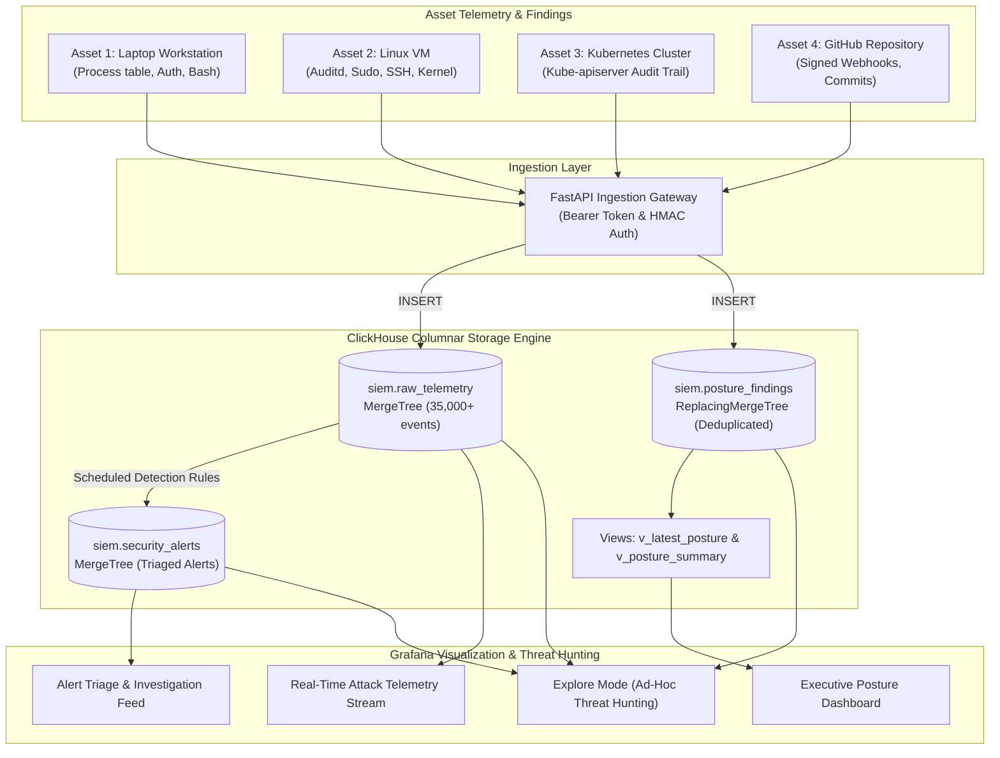

# A SOC Analyst's Practical Guide to Grafana & ClickHouse SIEM

> **Target Audience:** Security Operations Center (SOC) Analysts, Incident Responders, and Detection Engineers.  
> **Platform Stack:** Grafana v10.4.2 + ClickHouse v24.3 + Mini SIEM Multi-Asset Architecture.  
> **Monitored Assets:** Host Laptop (`laptop`), Linux Server VM (`vm`), Kubernetes Cluster (`k8s`), and GitHub Repository (`github`).

---

## 1. Architectural Overview for the SOC Analyst

Before firing queries, you must understand how telemetry transforms into security insights inside the SIEM data pipeline:



### The Three Core Tables in ClickHouse

| Table Name | Engine | Partition Key | Purpose & Contents |
|---|---|---|---|
| **`siem.raw_telemetry`** | `MergeTree()` | `toYYYYMM(timestamp)` | High-volume chronological security event logs from all 4 assets (process spawns, auditd syscalls, K8s API audits, git pushes). |
| **`siem.posture_findings`** | `ReplacingMergeTree(scan_timestamp)` | `toYYYYMM(scan_timestamp)` | Vulnerabilities (CVEs), CIS benchmark misconfigurations, and supply chain issues. Deduplicated in-place per `(asset_type, asset_id, finding_type, check_id)`. |
| **`siem.security_alerts`** | `MergeTree()` | `toYYYYMM(triggered_at)` | High-confidence alerts fired by detection rules, mapped to MITRE ATT&CK tactics/techniques with contextual forensic evidence. |

---

## 2. Navigating Grafana: Essential SOC Features

As an analyst, Grafana is your primary glass pane for situational awareness, anomaly spotting, and deep forensic drill-down.

### 2.1 Time Picker & Relative Range Mastery
The Time Picker (top right) is the single most critical filter in your investigations:
- **`now-15m` to `now`:** Live incident triage when an alert fires in real-time.
- **`now-6h` to `now`:** Standard shift handover and situational assessment.
- **`now-24h` / `now-7d`:** Trend analysis, baseline deviation, and campaign tracking.
- **Timezone Awareness:** Always verify whether your Grafana session is set to **Browser Time** (local timezone, e.g. IST UTC+5:30) or **UTC**. ClickHouse natively stores timestamps in `UTC`. For multi-analyst teams, standardizing on UTC prevents miscommunication during active bridge calls.

### 2.2 Auto-Refresh Rates
- Set to **`5s`** or **`10s`** during attack simulation and active incident response.
- Set to **`1m`** or **Off** when conducting detailed historical forensic analysis so your table rows don't shift while inspecting a specific log entry.

### 2.3 Dashboard Mode vs. Explore Mode
- **Dashboards:** Standardized, persistent operational views (KPIs, bar charts, posture scores, live tables).
- **Explore Mode (`/explore`):** The analyst's sandbox. Use Explore when chasing a hunch, testing an ad-hoc SQL query, or validating a new detection hypothesis without modifying the saved team dashboard.

### 2.4 Dashboard Variables (Dynamic Filtering)
Variables allow you to filter an entire dashboard on the fly without editing SQL queries:
- **`$asset_type`:** Dropdown for `laptop`, `vm`, `k8s`, `github`.
- **`$severity`:** Filter by `CRITICAL`, `HIGH`, `MEDIUM`, `LOW`, `INFO`.
- **`$time_window`:** Dynamic lookback interval.

---

## 3. Grafana ClickHouse SQL: Macro & Function Reference

The Grafana ClickHouse plugin provides specialized macros that dynamically substitute dashboard state into raw SQL queries.

### 3.1 Essential Grafana Macros

| Macro | Expansion Example | Usage in Query |
|---|---|---|
| **`$__timeFilter(column)`** | `column >= '2026-11-21 11:00:00' AND column <= '2026-11-21 17:00:00'` | Constrains time to the user's selected Time Picker range. Essential for fast queries on partitioned MergeTree tables. |
| **`$__fromTime`** | `'2026-11-21 11:00:00'` | Returns start of time picker as a DateTime string. |
| **`$__toTime`** | `'2026-11-21 17:00:00'` | Returns end of time picker as a DateTime string. |
| **`$__interval`** | `10s`, `1m`, `5m` | Dynamically calculated bin size based on panel width and selected time range. |

> [!TIP]
> Always place `$__timeFilter(timestamp)` inside the `WHERE` clause of queries on `siem.raw_telemetry`. Because `raw_telemetry` is partitioned by month and ordered by `timestamp`, the ClickHouse query engine will skip unneeded partitions and index granules, returning results in milliseconds even with millions of rows.

### 3.2 Key ClickHouse Analytical Functions for SOC Queries

1. **`toStartOfInterval(timestamp, INTERVAL 1 MINUTE)` / `toStartOfMinute(timestamp)`:**
   Bins time into discrete buckets for time-series charts.
2. **`uniqExact(column)`:**
   Calculates exact distinct count (e.g., number of unique actors or IP addresses).
3. **`countIf(condition)`:**
   Conditional counting in a single pass (e.g., `countIf(severity = 'CRITICAL')`).
4. **`topK(5)(column)`:**
   Returns the top 5 most frequent values (e.g., most active processes or targets).
5. **`groupArray(column)`:**
   Aggregates rows into an array for multi-event correlation.
6. **`JSONExtractString(raw_json, 'key')`:**
   Extracts arbitrary nested JSON fields without altering table schemas.

---

## 4. The SOC Analyst's Query Playbook

Here is a catalog of high-impact ClickHouse queries categorized by investigative objective. You can paste any of these directly into Grafana panels or Explore Mode.

---

### Scenario A: Situational Awareness & Fleet Overview

#### 1. Real-Time Telemetry Ingestion Velocity by Asset (Time-Series)
*Identifies data loss (flatlining collector) or sudden telemetry storms (DDoS / automated attacks).*

```sql
SELECT
    toStartOfMinute(timestamp) AS time,
    asset_type,
    count() AS events_per_minute
FROM siem.raw_telemetry
WHERE $__timeFilter(timestamp)
GROUP BY time, asset_type
ORDER BY time ASC;
```
- **Visualization:** Time Series (Stacked Bars or Smooth Lines).
- **Analyst Insight:** A sudden spike in `vm` or `k8s` indicates either an active automated attack or an operational issue (crash loop).

#### 2. Monitored Fleet Posture Health Matrix (Table)
*Provides instantaneous risk ranking across all four monitored asset classes.*

```sql
SELECT
    asset_type,
    asset_id,
    critical_count AS critical_vulns,
    high_count AS high_vulns,
    total_open_findings,
    last_scanned_at
FROM siem.v_posture_summary
ORDER BY critical_vulns DESC, high_vulns DESC;
```
- **Visualization:** Table with cell color overrides (Red for critical > 0).

---

### Scenario B: Linux VM Threat Hunting (`debianvm`)

#### 3. Unauthorized `/etc/shadow` Credential Access Hunting
*Detects attackers dumping password hashes via unprivileged tools or unauthorized sudo invocations.*

```sql
SELECT
    timestamp,
    actor,
    process_name,
    command_line,
    target_resource,
    severity
FROM siem.raw_telemetry
WHERE asset_type = 'vm'
  AND (target_resource = '/etc/shadow' OR command_line LIKE '%/etc/shadow%')
  -- False Positive Exclusion: Allow legitimate user authentication tools
  AND process_name NOT IN ('login', 'sshd', 'passwd', 'useradd')
ORDER BY timestamp DESC
LIMIT 50;
```
- **Visualization:** Table.
- **Triage Action:** If `process_name` is `cat`, `awk`, `python`, or `curl`, the system password database has been staged or dumped. Isolate the VM immediately.

#### 4. Persistence & Cron Injection Hunting
*Detects scheduled tasks dropped by attackers into `/etc/cron*` or reverse shell sockets.*

```sql
SELECT
    timestamp,
    actor,
    process_name,
    target_resource,
    command_line
FROM siem.raw_telemetry
WHERE asset_type = 'vm'
  AND (
      target_resource LIKE '/etc/cron%'
      OR command_line LIKE '%cron%'
      OR command_line LIKE '%/dev/tcp/%'
      OR command_line LIKE '%nc -e%'
      OR command_line LIKE '%bash -i%'
  )
  -- False Positive Exclusion: Allow system logrotate and package updates
  AND command_line NOT LIKE '%logrotate%'
ORDER BY timestamp DESC;
```
- **Visualization:** Table or Stat Callout.
- **MITRE Mapping:** T1053.003 (Cron), T1059.004 (Unix Shell).

---

### Scenario C: Kubernetes Threat Hunting (`siem-k8s-cluster`)

#### 5. Privileged Container Launch & Host Escape Hunt
*Detects containers launched with host root mounts (`hostPath: /`) or full kernel capabilities (`privileged: true`).*

```sql
SELECT
    timestamp,
    actor,
    event_type,
    target_resource,
    severity,
    command_line
FROM siem.raw_telemetry
WHERE asset_type = 'k8s'
  AND (
      event_type = 'create_privileged_pod'
      OR command_line LIKE '%privileged%'
      OR command_line LIKE '%hostPath%'
  )
  -- False Positive Exclusion: Allow authorized system CNI daemons
  AND actor NOT IN ('system:serviceaccount:kube-system:daemon-set-controller')
ORDER BY timestamp DESC;
```
- **Visualization:** Table with severity pills (`CRITICAL` highlighted in red).
- **Incident Response:** Any non-system account deploying a privileged pod indicates container breakout preparation (MITRE T1611).

#### 6. Interactive Pod Exec & Token Snooping Audit
*Detects sessions running interactive shell commands inside pods (`kubectl exec`).*

```sql
SELECT
    timestamp,
    actor,
    source_ip,
    target_resource AS target_pod,
    command_line
FROM siem.raw_telemetry
WHERE asset_type = 'k8s'
  AND (event_type LIKE '%exec%' OR command_line LIKE '%exec%')
  -- Exclude automated liveness probe agents if applicable
  AND actor NOT LIKE 'system:node:%'
ORDER BY timestamp DESC
LIMIT 50;
```
- **Visualization:** Table.
- **Forensic Context:** Look at the `target_pod` and correlate with subsequent network or secret read events from that pod.

---

### Scenario D: GitHub Supply Chain & Secret Leak Hunting

#### 7. Leaked Secrets & High-Entropy Credentials in Commits
*Detects commits containing AWS keys, private certificates, or GitHub tokens pushed to the repo.*

```sql
SELECT
    timestamp,
    actor,
    target_resource AS repository,
    command_line,
    JSONExtractString(raw_json, 'head_commit', 'message') AS commit_message,
    JSONExtractString(raw_json, 'head_commit', 'id') AS commit_sha
FROM siem.raw_telemetry
WHERE asset_type = 'github'
  AND (
      command_line LIKE '%AKIA%'
      OR command_line LIKE '%PRIVATE KEY%'
      OR command_line LIKE '%ghp_%'
      OR raw_json LIKE '%AKIA%'
      OR event_type LIKE '%secret_leak%'
  )
ORDER BY timestamp DESC;
```
- **Visualization:** Table with commit SHA and commit message columns.
- **Action:** Immediately revoke the credential in IAM / cloud provider and rewrite git history using `git-filter-repo`.

#### 8. Administrative Policy Tampering on Default Branch
*Detects attempts to bypass branch protection rules or push unreviewed commits directly to `main`.*

```sql
SELECT
    timestamp,
    actor,
    target_resource,
    event_type,
    command_line
FROM siem.raw_telemetry
WHERE asset_type = 'github'
  AND (
      command_line LIKE '%branch_protection%'
      OR (command_line LIKE '%refs/heads/main%' AND actor != 'lead_architect')
  )
ORDER BY timestamp DESC;
```

---

## 5. Visualizing Security Data: Selecting the Right Panel

| Visual Panel Type | Best Security Use Case in Grafana | Configuration Best Practices |
|---|---|---|
| **Stat / KPI Card** | Displaying high-urgency single numbers (e.g., Open Critical CVEs, Active Alerts in last 1h). | Use `colorMode: background`, configure thresholds: 0 = Green, $\ge 1$ = Red. |
| **Time Series (Bars)** | Tracking attack spikes and log volumes over time. | Set `drawStyle: bars`, `stacking: normal`, group by `severity` or `asset_type`. |
| **Table** | Forensic log review, alert triage lists, raw event investigation. | Enable `cellHeight: sm`, sort by `timestamp DESC`, add overrides for color-coded severity pills. |
| **Pie / Donut Chart** | Attack tactic breakdown (MITRE tactics) or event distribution per asset. | Set `pieType: donut`, display both value and percentage in labels. |
| **Gauge** | Fleet Security Posture Score (0% to 100%). | 0–50% = Red, 50–80% = Yellow, 80–100% = Green. |

---

## 6. Advanced SOC Workflows: Threat Hunting & Outlier Detection

### 6.1 Spotting Anomalies Using Baselines (Z-Score & Moving Average)
When hunting stealthy attackers, simple thresholds miss slow-and-low activity. ClickHouse allows you to calculate moving statistics across sliding time windows:

```sql
-- Detects hourly activity that deviates by more than 3 standard deviations from asset baseline
WITH hourly_counts AS (
    SELECT
        toStartOfHour(timestamp) AS hour,
        asset_id,
        count() AS event_count
    FROM siem.raw_telemetry
    WHERE timestamp >= now() - INTERVAL 7 DAY
    GROUP BY hour, asset_id
)
SELECT
    hour,
    asset_id,
    event_count,
    avg(event_count) OVER (PARTITION BY asset_id) AS avg_hourly_events
FROM hourly_counts
WHERE event_count > (avg(event_count) OVER (PARTITION BY asset_id) * 3)
ORDER BY event_count DESC;
```

### 6.2 Cross-Asset Multi-Stage Attack Correlation
An advanced adversary compromises GitHub, deploys a container in Kubernetes, and breaks out into the VM. Here is how an analyst correlates events across all 3 asset classes within a 30-minute window:

```sql
SELECT
    timestamp,
    asset_type,
    asset_id,
    actor,
    event_type,
    target_resource,
    command_line
FROM siem.raw_telemetry
WHERE timestamp >= now() - INTERVAL 1 HOUR
  AND (
      (asset_type = 'github' AND actor = 'negligent_developer')
      OR (asset_type = 'k8s' AND target_resource LIKE '%privileged%')
      OR (asset_type = 'vm' AND (target_resource = '/etc/shadow' OR target_resource = '/etc/cron.d'))
  )
ORDER BY timestamp ASC;
```

---

## 7. Performance & Optimization Rules for ClickHouse Queries

To keep your Grafana dashboards loading in sub-second timeframes under heavy event volume:

1. **Always Filter by Time:** Ensure `$__timeFilter(timestamp)` or a static `timestamp >= now() - INTERVAL X` is present in the `WHERE` clause. ClickHouse partitions by month (`toYYYYMM(timestamp)`); filtering on timestamp prunes unneeded disk blocks immediately.
2. **Filter by Primary Key First:** `siem.raw_telemetry` is ordered by `(asset_type, event_category, timestamp)`. Filtering on `asset_type = 'vm'` before searching strings allows the index to discard millions of irrelevant rows instantly.
3. **Avoid `SELECT *`:** Query only the columns you need for the panel (e.g. `timestamp`, `actor`, `command_line`). ClickHouse is columnar: reading 4 columns is 10x faster than reading 12.
4. **Use `LIMIT` on Exploration Queries:** Always append `LIMIT 50` or `LIMIT 100` when pulling tables for human review.

---

## 8. Summary Checklist for Shift Operations

When taking over a SOC shift with the Mini SIEM Grafana platform:

- [ ] **Step 1:** Verify Fleet Posture KPIs (top row). Confirm `Critical Posture Findings` are triaged.
- [ ] **Step 2:** Inspect `Telemetry Events by Asset Class` (donut chart). Confirm all 4 assets (`laptop`, `vm`, `k8s`, `github`) are reporting events.
- [ ] **Step 3:** Review `Alerts Volume Over Time` for severity spikes in the last 6–24 hours.
- [ ] **Step 4:** In the `Live Multi-Asset Telemetry & Attack Stream`, search for suspicious keywords: `shadow`, `cron`, `privileged`, `exec`, `AKIA`.
- [ ] **Step 5:** If an anomaly is identified, pivot to **Explore Mode**, paste the specific asset query from this playbook, narrow the time window, and initiate the incident response workflow.
